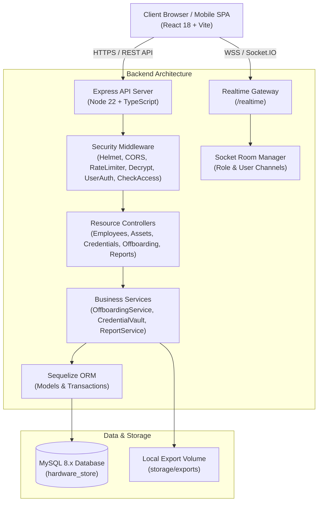

# System Architecture & Design

## 1. High-Level Architecture Overview

The IT Asset Management (ITAM) platform is designed as a secure, role-based monorepo consisting of:

1. **Frontend (`@hm/web`)**: Single-Page Application built on React 18, Vite, Tailwind CSS, TanStack React Query, React Hook Form, and Zod.
2. **Backend (`@hm/api`)**: Node.js/Express service utilizing TypeScript, Sequelize ORM, Socket.IO, Helmet, and express-rate-limit.
3. **Shared Contracts (`@hm/shared`)**: Canonical TypeScript types, enums, status codes, and constants shared across API and Web packages.
4. **Data Layer**: MySQL 8.x transactional database with Sequelize migrations, relational foreign keys, soft deletes, and SHA-256 tamper-evident hash chaining.

---

## 2. Core Architectural Patterns

### 2.1 Layered Request Pipeline

Every protected REST route follows a strict 6-stage lifecycle:

1. `decryptPayload`: Application-layer payload decryption if enabled.
2. `userAuth`: JWT verification, database user active status check, and request context hydration (`req.user`).
3. `checkAccess`: Role-based module and access type permission evaluation.
4. `validate`: Express-validator / Zod schema validation against whitelisted fields.
5. `Controller`: Transaction orchestration, business service invocation, and response formatting.
6. `createActivityLog`: Transactional audit logging linked to the cryptographic SHA-256 ledger.

### 2.2 Credential Vault Cryptography

The credential vault uses AES-256-GCM authenticated encryption:

- Key versioning (`key_version`) allows zero-downtime key rotation.
- Unique 12-byte initialization vector (`iv`) and 16-byte authentication tag (`auth_tag`) stored alongside ciphertext (`password_enc`).
- Passwords and secrets are NEVER logged in plaintext, never returned in list endpoints, and reveal accesses are recorded in `credential_access_logs`.

### 2.3 Cryptographic Hash Chains for Audit Logs

Both `activity_logs` and `credential_access_logs` maintain continuous SHA-256 hash chains:

- Each row calculates: `data_hash = SHA256(canonicalJson(row_data))`.
- Each row calculates: `row_hash = SHA256(previous_row_hash + data_hash)`.
- Verified at any time using `npm run audit:verify`.
