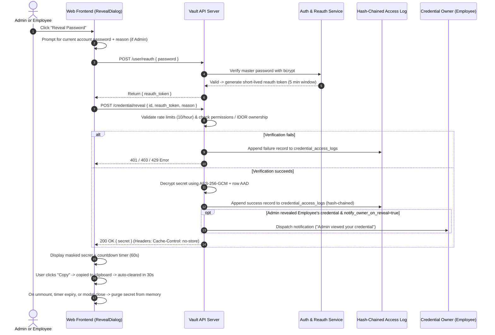

# Credential Vault — Security Design & Threat Model

**Document Version**: 1.0.0  
**Phase**: Phase 3 — Secure Credential Vault  
**Classification**: Internal Technical Specification  
**Last Updated**: November 18, 2026

---

## 1. Executive Summary & Objectives

The ITAM Credential Vault provides a centralized, cryptographically secure, and tamper-evident repository for managing both company-provided and employee-submitted digital identities and credentials (email, VPN, Git, Jira, cloud consoles, laptop logins, databases, and Wi-Fi).

### Core Security Objectives

1. **Confidentiality at Rest**: All stored passwords and sensitive secrets are encrypted using authenticated envelope encryption (AES-256-GCM) with row-bound Additional Authenticated Data (AAD).
2. **Zero Plaintext Leakage**: Secret fields are strictly excluded from default ORM scopes, list queries, exports, error payloads, application logs, and HTTP response caches (`Cache-Control: no-store`).
3. **Controlled Justified Reveal**: Viewing any password requires dual gates: active administrative permission / ownership + re-authentication with current account password + mandatory business justification + strict rate limits + owner notification.
4. **Tamper-Evident Audit Trails**: All credential access events and system activities are recorded in forward-secure, hash-chained append-only logs (`credential_access_logs` and `activity_logs`).
5. **Worker Consent & Boundary Enforcement**: Clear segregation between corporate tools and personal data, backed by a versioned legal consent gate before any employee submission.
6. **Account & Brute-Force Resilience**: Automated account lockout, login attempt auditing, and cryptographic password generators with entropy scoring.

---

## 2. Threat Model (STRIDE Analysis)

| Threat Category (STRIDE)   | Attack Surface / Vector                                                        | Threat Actor                           | Impact   | Mitigations Implemented                                                                                                                                                                                                                                                         |
| :------------------------- | :----------------------------------------------------------------------------- | :------------------------------------- | :------- | :------------------------------------------------------------------------------------------------------------------------------------------------------------------------------------------------------------------------------------------------------------------------------ |
| **Spoofing**               | Stolen session token used to reveal credentials                                | Malicious insider or external attacker | High     | **Re-Authentication Gate**: A short-lived (5 min) re-auth token (`POST /user/reauth`) requiring the user's master password is required to reveal any secret.                                                                                                                    |
| **Tampering**              | Database administrator or SQLi attacker modifying audit logs or ciphertext     | Privileged insider or compromised DB   | Critical | **AES-256-GCM Auth Tags & AAD**: Modifying ciphertext, IV, or moving ciphertext to another row fails authentication. **Hash-Chained Logs**: SHA-256 link (`hash = H(prev_hash \| canonical_row)`) immediately detects deleted, inserted, or modified audit rows.                |
| **Repudiation**            | Administrator denies viewing an employee's credentials                         | Rogue administrator                    | High     | **Mandatory Reason & Access Logging**: Admins must submit a ≥5 character justification. All attempts (success and failure) record IP, user-agent, timestamp, and are hash-chained. The employee is automatically notified.                                                      |
| **Information Disclosure** | Secret leaked via SQL queries, error traces, logs, or response JSON            | Any attacker / log reader              | Critical | **Default Scope Exclusion**: ORM excludes ciphertext/IV/tag by default. **Redaction Filter**: Global winston/activity sanitizer strips `password`, `secret`, `token`, etc. **Client Hygiene**: React Query `gcTime: 0`, auto-clear clipboard (30s), auto-close countdown (60s). |
| **Denial of Service**      | Brute-force guessing passwords or exhausting vault reveal capacity             | External script / bot                  | Medium   | **Account Lockout**: 5 failed login attempts lock the account for 15 minutes. **Reveal Rate Limiting**: 10 reveals/hour/user with exponential backoff on failures.                                                                                                              |
| **Elevation of Privilege** | IDOR: Employee A accessing Employee B's credentials via `/portal/credential/*` | Malicious employee                     | Critical | **Portal Isolation**: Portal endpoints enforce `WHERE employee_id = currentUser.employee_id` on all operations. Client-supplied `employee_id` is completely ignored and forbidden.                                                                                              |

---

## 3. Cryptographic Architecture

### 3.1 Encryption at Rest (AES-256-GCM)

- **Algorithm**: `AES-256-GCM` (Galois/Counter Mode) via Node.js native `crypto`.
- **Key Length**: 256 bits (32 bytes).
- **Initialization Vector (IV)**: 96 bits (12 bytes), generated via `crypto.randomBytes(12)` uniquely per record write/update. IV reuse is cryptographically catastrophic in GCM and is strictly prevented.
- **Authentication Tag**: 128 bits (16 bytes), stored in `auth_tag`. Guarantees ciphertext integrity and authenticity.
- **Additional Authenticated Data (AAD)**: Ciphertext is cryptographically bound to its row identity:
  $$\text{AAD} = \text{"credential\_id:"} \parallel \text{id} \parallel \text{":employee\_id:"} \parallel \text{employee\_id}$$
  If an attacker swaps ciphertexts between different employees or credential records in the database, decryption will fail because the AAD mismatch causes GCM authentication failure.

### 3.2 Key Management & Versioning

- Keys are supplied via the environment variable `VAULT_ENCRYPTION_KEYS` as a JSON map of version-to-base64 keys:
  ```json
  {
    "1": "a1b2c3d4e5f6...32bytesbase64...",
    "2": "f6e5d4c3b2a1...32bytesbase64..."
  }
  ```
- `VAULT_KEY_VERSION` defines the active key version for new writes and updates.
- In production (`NODE_ENV === "production"`), the application refuses to boot if `VAULT_ENCRYPTION_KEYS` or `VAULT_KEY_VERSION` is missing or invalid.
- Decryption selects the key corresponding to the record's stored `key_version`.

### 3.3 Key Rotation (`npm run vault:rotate`)

- Administrative script reads records encrypted with `key_version < VAULT_KEY_VERSION`.
- Re-encrypts ciphertext and generates fresh IVs and auth tags using the newest key version within transactional batches.
- Supports `--dry-run` to preview required migrations without writing to the database.

---

## 4. Secret Reveal Protocol & Flow

The reveal flow follows a rigorous multi-stage security pipeline:



---

## 5. Tamper-Evident Audit Hardening (Hash Chains)

Both `credential_access_logs` and `activity_logs` implement cryptographic forward-secure hash chaining:

### 5.1 Chain Algorithm

For each row $i$:
$$\text{hash}_i = \text{SHA-256}\left(\text{prev\_hash}_{i} \parallel \text{CanonicalJSON}(\text{row}_i \setminus \{\text{hash}\})\right)$$

- $\text{prev\_hash}_1$ for the genesis row is initialized to `"0000000000000000000000000000000000000000000000000000000000000000"`.
- Canonical JSON ensures deterministic key sorting and whitespace elimination.
- Log writes execute inside a database transaction with a row lock on the latest entry to ensure serialized consistency under concurrent writes.

### 5.2 Verification & Tamper Detection (`npm run audit:verify`)

- `GET /credential/access/verify` and `npm run audit:verify` recalculate the full chain from root to tip.
- If any log entry has been inserted, updated, or removed, the verification detects the exact broken sequence index.

---

## 6. Employee Consent & Boundary Policies

1. **Mandatory Acceptance**: Before submitting any credential in the portal, employees must sign the digital consent agreement:
   > _"Only submit work-related credentials. The company can access submitted credentials for authorized purposes."_
2. **State Storage**: `consent_accepted_at` timestamp and `consent_version` are persisted on the `users` record.
3. **Endpoint Gate**: `POST /portal/credential/add` and `PUT /portal/credential/update` reject requests with `422 Unprocessable Entity` if consent has not been granted for the active version.

---

## 7. Account Security & Rate Limiting

1. **Login Lockout**: After 5 consecutive failed login attempts within 15 minutes, the account is locked for 15 minutes (`locked_until`).
2. **Generic Error Responses**: Authentication errors return a standard message ("Invalid credentials") to eliminate username enumeration.
3. **Active Session Management**: Users can inspect all active JWT sessions (`GET /user/sessions`) with IP, user-agent, and device details, and revoke them individually (`DELETE /user/session/:id`).

---

## 8. Backup & Disaster Recovery Note

> [!IMPORTANT]
> Because ciphertexts in the database depend on `VAULT_ENCRYPTION_KEYS`, database backups are useless without a synchronized copy of the encryption keys. Encryption keys MUST be backed up separately in an isolated, secure secret manager (e.g. HashiCorp Vault, AWS Secrets Manager, or Google Cloud Secret Manager).
