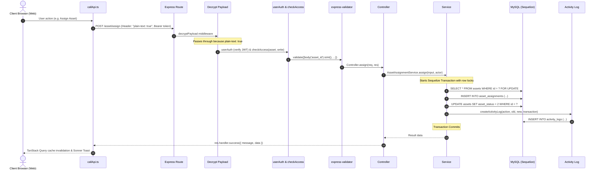
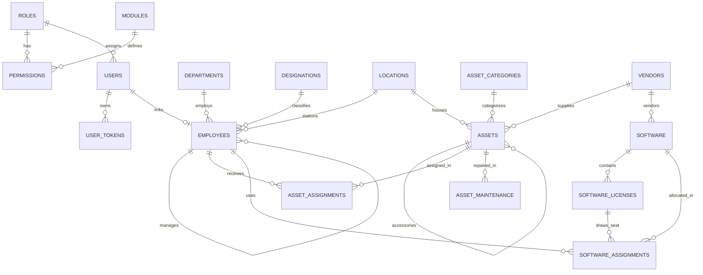

# IT Asset & Employee Management System (ITAM) — Project Context

> **Single Source of Truth** for developers and AI agents working on the ITAM codebase.  
> Last Verified Against Code: **November 18, 2026**

---

## 1. Project Overview & Business Goals

### 1.1 Purpose
The ITAM system is an in-house enterprise web application designed to manage office assets and personnel:
- **Employee lifecycle**: onboarding with login creation, departmental hierarchies, equipment assignment, and offboarding.
- **Hardware inventory**: asset tracking from procurement to retirement, serialized tags (`AST-XXXXXX`), QR code generation, accessory hierarchies, specifications, warranty alerts, and maintenance lifecycles.
- **Software & licenses**: license tracking, seat limits, automated expiry alerts, and employee seat allocations.
- **Access control & audit**: granular role-based access control (RBAC), full audit trails for compliance, and employee portal self-service.
- **Planned features**: credentials vault (AES-256-GCM encrypted), hardware/software request workflows, automated offboarding asset reclamation, and scheduled report exports.

### 1.2 Roles and Permissions Summary

| Role Name | Web Normalized Key | Database `type` | Capabilities & Access Matrix |
|---|---|---|---|
| **Super Admin** | `admin` | `super_admin` | Unrestricted full read/write/delete access across all modules, system settings, RBAC permissions matrix, and audit logs. |
| **Hardware Manager** | `hardware` | `hardware_manager` | Full management (read/write/delete) of assets, asset assignments, maintenance, software, and software licenses. Read/write on employees, vendors, locations, departments, designations, and asset categories. Read/write on own user profile. Cannot manage roles or system permissions. |
| **HR** | `hr` | `hr` | Full management (read/write) of employees, departments, designations, and locations. Read-only access to assets, asset assignments, maintenance, software, licenses, and audit logs. |
| **Employee** | `employee` | `employee` | Access to the employee self-service portal (`/portal`, `/portal/assets`, `/portal/software`), profile self-management, and read-only directory access. No access to hardware administration or master entities. |

---

## 2. Tech Stack, Commands & Environment

### 2.1 Technology Stack & Versions

#### Backend API (`hardware-mnagement-api`)
- **Runtime**: Node.js `v22.23.4` (ESM / CommonJS hybrid via `tsx` and TypeScript `5.9.3`)
- **Framework**: Express `5.2.1`
- **ORM / Database**: Sequelize `6.37.8`, MySQL2 `3.24.4` (MySQL 8.0+)
- **Security & Headers**: Helmet `8.1.0`, express-rate-limit `8.1.0`, bcrypt `6.0.0`
- **Validation & Parsing**: Zod `4.1.12` (env), express-validator `7.3.2`, csv-parse `7.0.3`, exceljs `4.4.0`
- **Cryptography**: crypto-js `4.2.0` (payload decryption), Node `crypto` AES-256-GCM (vault)
- **Utilities & Docs**: node-cron `4.2.1`, qrcode `1.5.4`, winston `3.19.0`, swagger-ui-express `5.0.1`
- **Testing & Quality**: Vitest `4.0.8`, Supertest `7.1.4`, ESLint `9.39.1`, Prettier `3.6.2`, Husky `9.1.7`

#### Frontend Web (`hardware-management-web`)
- **Framework & Tooling**: React `18.3.1`, Vite `6.4.1`, TypeScript `5.8.3`
- **Styling & UI**: Tailwind CSS `3.4.17`, Radix UI primitives (`dialog`, `select`, `dropdown-menu`, `switch`, `alert-dialog`, `slot`), Lucide React `0.462.0`
- **State Management**: TanStack React Query `5.83.0` (server state), Zustand `5.0.11` (client session/auth)
- **Forms & Validation**: react-hook-form `7.61.1`, Yup `1.7.1`, `@hookform/resolvers` `3.10.0`
- **Routing & Feedback**: React Router DOM `6.30.1`, Sonner `1.7.4`, Recharts `2.15.4`
- **Testing & Quality**: Vitest `4.1.0`, React Testing Library `16.0.0`, ESLint `9.32.0`, Prettier `3.9.10`

### 2.2 Execution Commands

#### API Commands (`cd hardware-mnagement-api`)
```bash
# Start development server with live reload (port 8000)
npm run dev

# Run TypeScript compilation
npm run build

# Start production build
npm run start

# Database migrations
npm run migrate

# Seed initial RBAC and default admin
npm run seed

# Seed development performance fixtures (100k employees + 100k assets)
npm run seed:bulk

# Static analysis and formatting
npm run typecheck
npm run lint

# Run unit tests
npm test

# Run full database integration tests (requires MySQL running)
OPTIONS_DB_INTEGRATION=1 PHASE2_DB_INTEGRATION=1 npm test

# Run 100k keyset cursor performance benchmark
OPTIONS_PERF_TEST=1 OPTIONS_DB_INTEGRATION=1 npx vitest run tests/options_builder.test.ts

# Generate new module scaffold
npm run gen:module -- <snake_case_resource>
```

#### Web Commands (`cd hardware-management-web`)
```bash
# Start Vite development server (port 5173)
npm run dev

# Production build (typecheck + vite build)
npm run build

# Static checks and UI guardrails
npm run typecheck
npm run lint
npm run check:ui

# Run unit/DOM tests
npm test

# Generate new module starter files
npm run gen:module -- <resource-name> --fields "name:text,status:enum"
```

### 2.3 Environment Configuration (Variable Keys Only)

> [!WARNING]
> Never commit actual credentials or secrets to version control. The keys below represent the configuration contracts.

#### API (`hardware-mnagement-api/.env`)
```ini
PORT
NODE_ENV
DB_USERNAME
DB_PASSWORD
DB_HOST
DB_PORT
DB_DATABASE
DB_CONNECTION
DB_LOGGING
SECRET_KEY
ACCESS_TOKEN_EXPIRES
REFRESH_TOKEN_EXPIRES
CORS_ORIGINS
ENCRYPTION_SECRET
VAULT_ENCRYPTION_KEY
MAIL_SERVICE
MAIL_HOST
MAIL_PORT
MAIL_SECURE
MAIL_USERNAME
MAIL_EMAIL
MAIL_PASSWORD
IS_OTP_GENERATE_STATIC
IS_STATIC_EMAIL
CURRENT_UPLOAD_TYPE
SERVER_ASSETS_BASE_PATH
SERVER_PATH
SUPER_ADMIN_EMAIL
SUPER_ADMIN_PASSWORD
TZ
```

#### Web (`hardware-management-web/.env`)
```ini
VITE_HOST_API
```

### 2.4 Default Admin & Seed Setup
1. Running `npm run migrate` sets up the schema up to `20261117120000-create-assets-software.js`.
2. Running `npm run seed` executes:
   - `20261117091000-seed-rbac.js`: Creates 21 modules, 4 default roles (`super_admin`, `hardware_manager`, `hr`, `employee`), and populates the 53 initial permission entries.
   - `20261117092000-seed-super-admin.js`: Creates the primary Super Admin account using `SUPER_ADMIN_EMAIL` and `SUPER_ADMIN_PASSWORD` from `.env`.
3. Running `npm run seed:bulk` adds 100k employee rows and 100k asset rows for keyset cursor pagination stress testing.

---

## 3. Architecture & Codebase Layout

### 3.1 Folder Structures

#### API Project Tree (`hardware-mnagement-api/`)
```text
hardware-mnagement-api/
├── Config/                  # App configuration, Zod env parser, Winston logger, AppError, response envelope
├── Controllers/             # Request handlers adapting Express requests to typed service calls
├── Database/
│   ├── Migrations/          # Sequelize database migrations (timestamped, forward-only)
│   ├── Schema/              # Sequelize model definitions and relational associations
│   │   └── phase2/          # Phase 2 domain schema column specifications
│   └── Seeders/             # Idempotent database seeders (RBAC, super admin, bulk stress fixtures)
├── dist/                    # Compiled JavaScript production build output
├── docs/                    # Architecture layout and conformance audits
├── Jobs/                    # Node-cron automated jobs (daily expiry alert scheduler)
├── Middleware/              # Authentication (JWT), cryptography (payload), error handler, express-validator
├── Models/                  # Sequelize domain model accessors and database queries
├── Routes/                  # Express route declarations with middleware and parameter validation
├── scripts/                 # CLI scaffolding tools (gen-module.mjs)
├── Services/                # Core business logic, multi-step transactions, row locking, and activity logs
├── Swagger/                 # OpenAPI 3.0 path and schema definitions
├── tests/                   # Vitest unit and integration test suites
├── Types/                   # Shared TypeScript declarations, options types, Express request extensions
├── Utils/                   # Async handler, cryptographic helpers, options builder, validation helpers
├── package.json             # NPM package specification and build scripts
├── server.ts                # Application entrypoint (database authentication, cron registration, HTTP listen)
├── tsconfig.json            # Strict TypeScript configuration
└── vitest.config.cjs        # Vitest test runner configuration
```

#### Web Project Tree (`hardware-management-web/`)
```text
hardware-management-web/
├── docs/                    # UI standards, select audit, conformance audits, module checklist
├── public/                  # Static assets and favicons
├── scripts/                 # Architecture enforcement (check-ui.mjs) and module generator (gen-module.mjs)
├── src/
│   ├── api/                 # Typed API client (callApi), endpoint constants, per-resource API wrappers
│   ├── components/
│   │   ├── auth/            # ProtectedRoute, RoleGuard, PermissionGuard
│   │   ├── common/          # CommonTable, PageHeader, Drawer, FormLayout, FilterPanel, RowActionsMenu
│   │   ├── hook-form/       # FormProvider, RHF fields library (text, select, async-select, switch, etc.)
│   │   ├── layout/          # AppShell (collapsible sidebar, responsive header, notification bell, theme)
│   │   └── ui/              # Base Radix and Tailwind UI primitives (button, dialog, card, badge, select)
│   ├── hooks/               # Custom hooks (table state, table filters, async options, drawer state, debounce)
│   ├── lib/                 # Utility functions, role normalization helpers
│   ├── pages/               # Routed page views and feature components (flat layout)
│   ├── routes/              # Route paths definitions (paths.ts) and router configuration (sections.tsx)
│   ├── test/                # Test utilities, mocks, and setup files
│   ├── types/               # TypeScript domain interfaces, API result envelopes, user session contracts
│   ├── utils/               # UI constants, status badge tone resolvers, date/currency formatters
│   ├── zustand/             # Global client state (user-store for authentication session)
│   ├── App.tsx              # Root component mounting React Query Provider and RouterProvider
│   ├── index.css            # Tailwind base directives and CSS theme design tokens
│   └── main.tsx             # Application DOM mount
├── package.json             # NPM package specification and frontend dependencies
├── tailwind.config.ts       # Tailwind theme extensions and token mappings
├── tsconfig.json            # Project reference TypeScript configuration
└── vite.config.ts           # Vite bundler configuration and path aliases (@/* -> src/*)
```

### 3.2 Request Flow Architecture


### 3.3 Core Infrastructure Subsystems

#### Authentication & Session Lifecycle
1. **Login** (`POST /user/login`): Validates email/password against bcrypt hash; generates access token (JWT) and refresh token; records SHA-256 hashed refresh token in `user_tokens`.
2. **Access Verification**: `userAuth` middleware validates the Bearer JWT token and resolves user permissions from the database.
3. **Silent Refresh**: Web `callApi.ts` intercepts HTTP 401 responses, queues concurrent requests via `refreshInFlight`, calls `POST /user/refresh/token`, updates the session in Zustand `useAuthStore`, and retries the original request seamlessly.
4. **Logout** (`DELETE /user/logout`): Revokes token entry from `user_tokens`.

#### Cryptography & Encryption Behavior
- **Network Payload Encryption**: Legacy invsys encryption retained in API via crypto-js. The web client passes `"plain-text": "true"` to bypass payload decryption during standard REST consumption.
- **Vault Encryption (AES-256-GCM)**: Authenticated encryption implemented in `Utils/encryption.ts` using `VAULT_ENCRYPTION_KEY`. Formats cipher text as `iv.authTag.ciphertext` in base64url. Used for software license keys; architected for Phase 3 credentials vault.
- **Passwords**: Hashed with bcrypt (10 rounds).
- **Tokens**: Refresh and password reset tokens are hashed with SHA-256 prior to database persistence.

#### Role-Based Access Control (RBAC)
- Checked via `checkAccess(module, accessType)` middleware requiring `read_access`, `write_access`, or `delete_access` from the `permissions` table for the user's role.
- Options queries are authorized via `checkOptionsAccess(module)`, which permits loading reference select options via `options_access: 1` even if the user lacks full table read permissions.

#### Activity Logging
- Every mutating write operation across all models and services invokes `createActivityLog` within the active Sequelize transaction.
- Captures `module`, `moduleId`, `action` (`created`, `updated`, `deleted`, `completed`, etc.), `old_value`, `new_value`, `description`, and `created_by` / `created_by_name`.

#### Global Error Handling
- Handled centrally by `Middleware/error_handler.ts`.
- Formats known `AppError` instances, Zod errors, Sequelize constraint violations, and unhandled exceptions into the standard `{ message, data: null }` error shape.

---

## 4. Conventions and Standards

| Area | Standard Specification | Documentation Source |
|---|---|---|
| **API Response Shape** | Standard envelope: `{ message: string, data: T \| null }`. | `Config/response_handler.ts` |
| **List API Contract** | `POST /<resource>/list` body: `{ currentPage, itemsPerPage, filters, sortBy, general_search }` -> `{ rows: T[], count: number }`. | `Utils/validations.ts`, `docs/API_STANDARDS.md` |
| **Options API Contract** | `POST /<resource>/options` body: `{ search, page, limit, ids[], filters{}}` -> `{ rows: [{ value, label, subLabel, meta }], count, hasMore, page }`. | `Utils/options_builder.ts`, `docs/FORM_FIELD_GUIDELINES.md` |
| **URL Paths** | Conventional REST-like pattern: `/x/add`, `/x/list`, `/x/get/:id`, `/x/update`, `/x/delete/:id`, `/x/options`, `/x/activity`. | `docs/API_STANDARDS.md` |
| **Soft Delete** | `status`: `1` (Active), `0` (Inactive), `2` (Deleted). Queries filter `status: 1`. | `Config/constant.ts` |
| **Common Table** | `CommonTable` owns search debouncing, column visibility, density, sort, multi-selection, CSV export, loading skeleton, and mobile card toggle. | `src/components/common/CommonTable.tsx` |
| **Filter Panel** | `TableFilterPanel` expands above table, config-driven by `<Resource>Filters.ts`, synced to URL search parameters via `useTableFilters`. | `components/common/TableFilters/TableFilterPanel.tsx` |
| **Forms & Drawers** | Forms open in responsive `Drawer` (full-screen sheet on mobile), wrapped in `FormProvider`, organized into `FormSection` / `FormGrid` / `FormActions`, guarded by dirty-close checks. | `components/common/FormLayout.tsx`, `docs/UI_STANDARDS.md` |
| **Form Validation** | Co-located Yup schemas beside components (`<Resource>.schema.ts`); error messages sourced from `FORM_VALIDATION`. | `src/utils/form-validation.ts` |
| **React Query Hooks** | Target convention: custom hooks in `src/hooks/queries/<resource>.ts` (`useXList`, `useX`, `useCreateX`). Mutations handle invalidation and toasts. *(Note: currently implemented inline in pages)*. | `docs/UI_STANDARDS.md` |

---

## 5. Database Schema & Relations

### 5.1 Tables by Functional Group



### 5.2 Key Database Constraints & Engine Invariants
1. **Concurrency Protection for Asset Assignments**:
   - `asset_assignments.open_asset_id` is a persistent virtual generated column: `CASE WHEN returned_at IS NULL THEN asset_id ELSE NULL END`.
   - Unique index `asset_assignments_open_asset_unique` enforces that an asset can never have more than one open assignment at any given time.
2. **Software Seat Integrity**:
   - `software_assignments.open_employee_software` is a persistent generated column: `CASE WHEN revoked_at IS NULL THEN CONCAT(software_id, '-', employee_id) ELSE NULL END`.
   - Unique index `software_assignments_open_employee_unique` prevents duplicate concurrent assignments of the same software to an employee.
3. **Notification Deduplication**:
   - Unique constraint `notifications_alert_dedupe_unique` on `(record_type, record_id, threshold_days, kind)` prevents duplicate automated alerts.
4. **Optimized Options Keyset Search**:
   - Virtual generated stored columns `search_text` and `label_sort` on `employees` backed by composite B-Tree indexes for sub-2ms cursor pagination.

### 5.3 System Enums and Constants

- **Record Status**: `0` = Inactive, `1` = Active, `2` = Deleted
- **Asset Status**: `1` = Available, `2` = Assigned, `3` = Pending Return, `4` = In Repair, `5` = Retired, `6` = Lost
- **Asset Condition**: `'new'`, `'good'`, `'fair'`, `'poor'`
- **Software License Types**: `'per_user'`, `'per_seat'`, `'subscription'`, `'perpetual'`, `'free'`
- **Employment Status**: `1` = Active, `2` = Notice, `3` = Resigned, `4` = Exited

---

## 6. Complete Module Catalogue

| Module Name | Purpose & Scope | API Endpoints | Web Pages & Components | RBAC Key | Activity Key | Tests Present |
|---|---|---|---|---|---|---|
| **Users** | System login accounts & administrative user management | `/user/add`, `/user/update`, `/user/get/:id`, `/user/list`, `/user/options`, `/user/delete/:id`, `/user/profile`, `/user/profile/update` | `src/pages/Entities.tsx` (`Users`), `src/pages/Profile.tsx` | `user` | `user` | Route tests in `api.test.ts` |
| **Roles & Permissions** | Access control levels and module permission matrix | `/role/add`, `/role/update`, `/role/get/:id`, `/role/list`, `/role/options`, `/role/delete/:id`, `/role/:id/permissions`, `/module/permission` | `src/pages/Roles.tsx`, `src/pages/Entities.tsx` (`Roles`) | `role` | `role` | `api.test.ts`, `roles.test.ts` |
| **Employees** | Staff directory, employment records, linked user logins | `/employee/add`, `/employee/update`, `/employee/get/:id`, `/employee/list`, `/employee/options`, `/employee/delete/:id`, `/employee/bulk/import` | `src/pages/Entities.tsx` (`Employees`), `src/pages/EmployeeDetail.tsx` | `employee` | `employee` | Options & DB tests |
| **Departments** | Organizational departments | `/department/add`, `/department/update`, `/department/get/:id`, `/department/list`, `/department/options`, `/department/delete/:id` | `src/pages/Entities.tsx` (`Departments`) | `department` | `department` | CRUD tests in `api.test.ts` |
| **Designations** | Job roles and job titles | `/designation/add`, `/designation/update`, `/designation/get/:id`, `/designation/list`, `/designation/options`, `/designation/delete/:id` | `src/pages/Entities.tsx` (`Designations`) | `designation` | `designation` | CRUD via resource test |
| **Locations** | Office buildings, branches, sites | `/location/add`, `/location/update`, `/location/get/:id`, `/location/list`, `/location/options`, `/location/delete/:id` | `src/pages/Entities.tsx` (`Locations`) | `location` | `location` | CRUD via resource test |
| **Vendors** | Hardware and software suppliers | `/vendor/add`, `/vendor/update`, `/vendor/get/:id`, `/vendor/list`, `/vendor/options`, `/vendor/delete/:id` | `src/pages/Entities.tsx` (`Vendors`) | `vendor` | `vendor` | CRUD via resource test |
| **Asset Categories** | Equipment types (Laptops, Monitors, Phones) | `/asset_category/add`, `/asset_category/update`, `/asset_category/get/:id`, `/asset_category/list`, `/asset_category/options`, `/asset_category/delete/:id` | `src/pages/Entities.tsx` (`AssetCategories`) | `asset_category` | `asset_category` | CRUD via resource test |
| **Assets** | Hardware inventory, tags, specs, warranty, QR codes | `/asset/add`, `/asset/update`, `/asset/get/:id`, `/asset/list`, `/asset/options`, `/asset/delete/:id`, `/asset/qr/:id`, `/asset/import`, `/asset/export` | `src/pages/Assets.tsx`, `src/pages/AssetDetail.tsx` | `asset` | `asset` | `phase2_database.test.ts` |
| **Asset Assignments** | Hardware check-out, return, and transfer | `/asset/assign`, `/asset/return`, `/asset/transfer`, `/asset/bulk/assign`, `/asset/bulk/return`, `/asset/history` | Handled via dialogs in `Assets.tsx`, `AssetDetail.tsx`, `EmployeeDetail.tsx` | `asset_assignment` | `asset_assignment` | `phase2_database.test.ts` |
| **Asset Maintenance** | Repair tracking, vendor servicing, costs | `/asset/maintenance/add`, `/asset/maintenance/update`, `/asset/maintenance/complete`, `/asset/maintenance/list` | `src/pages/Maintenance.tsx`, tabs in `AssetDetail.tsx` | `asset_maintenance` | `asset_maintenance` | Tested in service pass |
| **Software** | Software titles, renewal dates, categories | `/software/add`, `/software/update`, `/software/get/:id`, `/software/list`, `/software/options`, `/software/delete/:id`, `/software/usage/:id` | `src/pages/Software.tsx`, `src/pages/SoftwareDetail.tsx` | `software` | `software` | `phase2_database.test.ts` |
| **Software Licenses** | License keys (encrypted), seat caps, expiry dates | `/software/license/add`, `/software/license/update`, `/software/license/list`, `/software/license/options` | Tabs & dialogs in `SoftwareDetail.tsx` | `software_license` | `software_license` | `phase2_database.test.ts` |
| **Software Assignments** | Seat assignment and revocation | `/software/assign`, `/software/revoke` | Dialogs in `Software.tsx`, `SoftwareDetail.tsx`, `EmployeeDetail.tsx` | `software` | `software` | `phase2_database.test.ts` |
| **Notifications** | Automated threshold alerts and user notifications | `/notifications`, `/notifications/read/:id`, `/notifications/read-all`, `/notifications/unread-count` | `src/pages/Notifications.tsx`, Header in `AppShell.tsx` | `user` | N/A | Service tests |
| **Dashboard** | Inventory metrics, alerts summary, cost aggregation | `/dashboard/summary` | `src/pages/Dashboard.tsx` | Open to authenticated | N/A | Manual smoke test |
| **Employee Portal** | Self-service view of assigned assets and software | `/portal/assets`, `/portal/software` | `src/pages/Portal.tsx`, `src/pages/PortalAssets.tsx`, `src/pages/PortalSoftware.tsx` | `employee` | N/A | Route guard tests |
| **Audit Logs** | System-wide immutable compliance audit log | `/audit/list`, `/audit/export` | `src/pages/AuditLogs.tsx` | `audit_log` | N/A | Export and filter tests |

---

## 7. Shared Components & Utilities Inventory

### Frontend Component Catalog
- **UI Primitives (`src/components/ui/`)**: `Button`, `Input`, `Textarea`, `Card`, `Badge`, `Skeleton`, `Dialog`, `Select`.
- **Form System (`src/components/hook-form/`)**:
  - `FormProvider`: RHF context container.
  - `RHFTextField`, `RHFPasswordField`, `RHFNumberField`, `RHFCurrencyField`, `RHFTextArea`.
  - `RHFSelect`, `RHFAsyncSelect` (infinite scroll, server search, ID hydration).
  - `RHFMultiSelect` (removable chips, async search).
  - `RHFSwitch`, `RHFRadioGroup`, `RHFTagsInput`.
- **Layout & Structure (`src/components/common/`)**:
  - `CommonTable`: Advanced table engine with column toggle, sorting, pagination, density, mobile card cards.
  - `PageHeader`: Standard view header with breadcrumb navigation and action slots.
  - `Drawer`: Slide-over form drawer with responsive mobile full-screen expansion.
  - `FormLayout`: `FormSection`, `FormGrid`, `FormActions`.
  - `TableFilterPanel`: Collapsible filter panel with active filter badge chips and URL query sync.
  - `RowActionsMenu`: Dropdown action menu for table rows.
  - `KeyValueEditor`: Key/value spec editor for hardware assets.
  - `ConfirmDialog`: Modal confirmation for destructive operations.
  - `ReferenceLabel`: Reactive ID-to-label hydration component.
  - `StatusBadge`: Badges with tones (`success`, `warning`, `danger`, `muted`, `info`).

### Custom Hooks (`src/hooks/`)
- `useTableState`: Manages table pagination, sorting, search, and page size.
- `useTableFilters`: Syncs filter criteria with URL query parameters.
- `useAsyncOptions`: Infinite paging, debounced search, and ID hydration against `/options` endpoints.
- `useFormDrawer`: Dirty form confirmation and drawer open/close orchestration.
- `useDebounce`, `useBoolean`, `useExportCsv`.

---

## 8. Known Issues, Technical Debt & Open TODOs

1. **Missing Documentation Files**:
   - `docs/OPTIONS_PAGINATION_REPORT.md` (Claimed done in Phase 2 brief; missing).
   - `docs/ASSET_SOFTWARE_PARITY_AUDIT.md` (Claimed prompted; missing).
   - Before/after visual parity screenshots are missing.
2. **API Select Validation Gap**:
   - `validateExists` middleware is missing on employee creation and update routes. Department, designation, location, and manager IDs are not validated for active existence prior to insertion.
   - `ResourceModel.list` returns raw records without joined association objects, forcing the web client to execute client-side hydration via `ReferenceLabel`.
3. **Swagger Documentation Incomplete**:
   - Only Phase 1 master endpoints and user routes exist in `Swagger/`. None of the Phase 2 routes (`/asset/*`, `/software/*`, `/portal/*`, etc.) are documented.
4. **UI Native Control Allowlist**:
   - 15 legacy files remain on the allowlist in `scripts/check-ui.mjs` (including `Assets.tsx`, `Software.tsx`, and `ResourcePage.tsx`) using native controls instead of shared `components/ui` components.
5. **Inline React Query Hooks**:
   - React Query hooks (`useQuery`, `useMutation`) are declared inline inside page components rather than isolated in `src/hooks/queries/<resource>.ts`.
6. **Code Scaffolding Generators are Stubs**:
   - Both API and Web `gen:module` scripts create placeholder comments and skeleton files rather than fully working implementations.
7. **Test Suite Database Overrides**:
   - `tests/setup.ts` overrides DB credentials to `itam_test` unless integration flags are present, causing `OPTIONS_PERF_TEST=1` to fail if run in isolation.
8. **Missing Automated Visual & Accessibility Tests**:
   - Responsive breakpoint testing (360/768/1024/1440px) and Axe accessibility audits have not been integrated into CI/testing.

---

## 9. Security & Risk Assessment

- **Credentials Vault Readiness**: The core cryptographic functions (`encryptVaultSecret` and `decryptVaultSecret` with AES-256-GCM) are tested and secure. However, the database schema, access policies, re-authentication challenges, and audit log tables for Phase 3 credentials vault have not been designed or created.
- **Payload Encryption Bypass**: The API supports payload encryption, but accepts `"plain-text": "true"` from the web client. Ensure network transport is strictly guarded by HTTPS/TLS in production.
- **Rate Limiting**: Rate limiting is configured for login (5 req/15min) and recovery (5 req/60min), plus a general IP limit of 600 req/min. Mutating data endpoints currently lack fine-grained rate limits.
- **CORS Configuration**: Restricts access based on the comma-separated `CORS_ORIGINS` environment variable. Defaults should be locked down in production deployments.

---

## 10. How to Add a New Module

### 10.1 Backend API Steps
1. Run `npm run gen:module -- <resource_name>`.
2. Define the schema in `Database/Schema/<resource_name>.ts` and export it in `Database/Schema/index.ts`.
3. Create a timestamped migration in `Database/Migrations/` defining tables, foreign keys, and indexes.
4. Add the model definition in `Models/<resource_name>.ts`.
5. Implement business rules, row locking, and `createActivityLog` in `Services/<resource_name>.ts`.
6. Implement request handling in `Controllers/<resource_name>.ts`.
7. Configure routes, validation, and RBAC in `Routes/<resource_name>.ts`, and mount in `Routes/index.ts`.
8. Register options builder config in `Utils/options_builder.ts` and export the options route.
9. Register module in `Config/constant.ts` (`MODULES` and `RESOURCE_MODULES`) and in `Database/Seeders/20261117091000-seed-rbac.js`.
10. Add OpenAPI documentation in `Swagger/<resource_name>.ts`.
11. Add unit and integration tests in `tests/<resource_name>.test.ts`.

### 10.2 Frontend Web Steps
1. Run `npm run gen:module -- <resource-name> --fields "field1:text,field2:enum"`.
2. Define API endpoints in `src/api/<resource-name>/index.ts` and `src/api/endpoint.ts`.
3. Add enum constants and tone mappings to `src/utils/constants.ts`.
4. Create React Query hooks under `src/hooks/queries/<resource-name>.ts`.
5. Configure table columns (`<Resource>Columns.tsx`) and filter definitions (`<Resource>Filters.ts`).
6. Build create/edit drawer form using `FormProvider`, `FormLayout`, and `<Resource>.schema.ts`.
7. Register URL in `src/routes/paths.ts` and route element in `src/routes/sections.tsx` with `PermissionGuard`.
8. Add sidebar navigation entry in `src/components/layout/AppShell.tsx`.
9. Verify compliance via `npm run check:ui`, `npm run typecheck`, and `npm test`.

---

## 11. Open Questions for System Architecture

1. **Designation to Department Hierarchy**: Should designations be strictly scoped to a specific department in the database schema, or remain globally available across departments?
2. **Manager & Approver Eligibility Policies**: Should employee `manager_id` selection be constrained to users holding specific roles (e.g. `super_admin`, `hardware_manager`), or remain open to any active employee?
3. **Payload Encryption Strategy**: Should crypto-js payload encryption be formally deprecated and replaced exclusively with standard TLS/HTTPS, or will payload encryption be mandated for production client requests?
4. **Phase 2 Swagger Backfill**: Should Phase 2 routes (`/asset/*`, `/software/*`, etc.) be documented in Swagger before starting Phase 3 features?
5. **UI Native Control Migration Strategy**: Should we complete the refactoring of the 15 legacy files on the allowlist (converting `Assets.tsx`, `Software.tsx`, etc. to `FormProvider` + `Drawer`) before implementing Phase 3?

