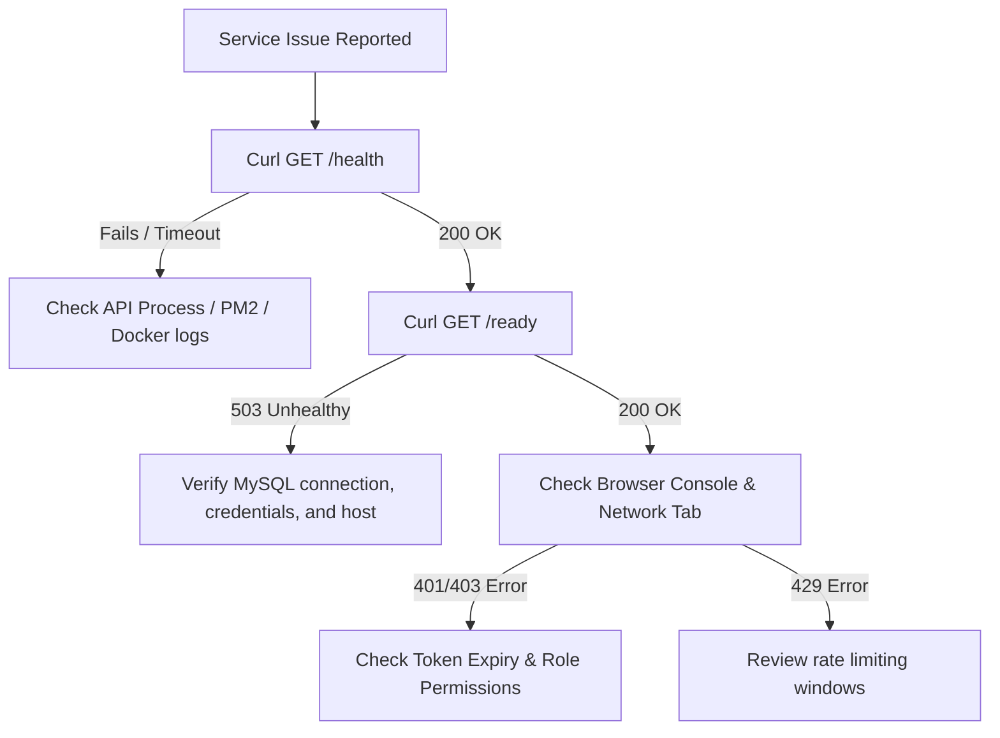

# Troubleshooting & Incident Resolution Guide

## 1. Quick Diagnostic Flowchart

---

## 2. Common Errors and Solutions

### 2.1 "You do not have sufficient permissions to perform this action" (HTTP 403)

- **Root Cause**: The user's role does not have the required access permission for this module or action.
- **Resolution**:
  - Super admins can adjust role permissions in **Administration** -> **Roles & Permissions**.
  - For reports: Verify whether the report is restricted to specific roles (e.g. Credential Approvals report is restricted to `super_admin`).

### 2.2 "Cannot connect to server" (HTTP Error / ECONNREFUSED)

- **Root Cause**: Backend API server is stopped or crashing on boot.
- **Resolution**:
  - Check process logs: `docker compose logs api` or check stdout.
  - Test connectivity directly: `curl -v http://localhost:8000/health`.
  - Verify database connectivity: Ensure MySQL port 3306 is listening.

### 2.3 "Certificate Verification Failed"

- **Root Cause**: Submitted document verification code does not match any completed offboarding clearance or has been tampered with.
- **Resolution**: Confirm code format matches `CLR-YYYY-XXXXX` and case has reached `Completed` status.
