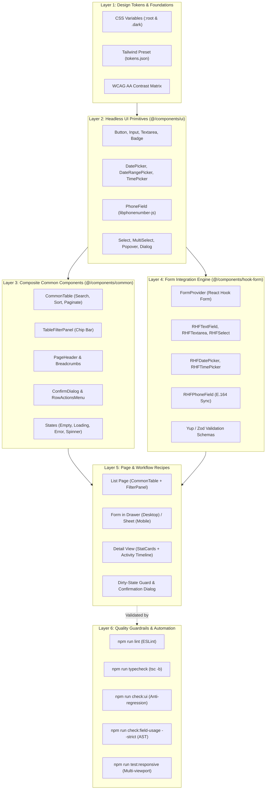

# UI Architecture Overview & Core Principles

**Generated**: 2026-11-24  
**Audit Scope**: Front-end architecture of `apps/web/src`  
**Standard Pack Master Index**: `docs/ui-standard/00-README.md`

---

## 1. Core Philosophy

The fundamental philosophy of this UI architecture is **strict uniformity through self-defending guardrails**:

1. **Single Source of Truth**: There is exactly one way to render a button, one way to collect an international telephone number, one way to present a paginated data table, and one way to lay out a form drawer.
2. **Zero One-Off UI**: Bespoke CSS classes, arbitrary inline styles, and unstyled native HTML elements are strictly prohibited in application screens. If a layout or input variant is required, it must be authored, typed, and tested in the shared component library first.
3. **Self-Defending Architecture**: Quality and consistency are not maintained through code review goodwill alone; they are enforced by 6 automated static and dynamic gates that fail pull requests immediately if an engineer attempts to bypass the shared standard.

---

## 2. The Five Non-Negotiables

Every engineer (human or AI) contributing to the codebase must observe these five non-negotiable rules:

|   #   | Non-Negotiable Rule                                                                                                                                                                                                    | Enforcement Mechanism                             |
| :---: | :--------------------------------------------------------------------------------------------------------------------------------------------------------------------------------------------------------------------- | :------------------------------------------------ |
| **1** | **No Native Form Controls Outside `@/components/ui`** Native `<input>`, `<select>`, and `<textarea>` elements in domain code are strictly forbidden. All forms must use `@/components/hook-form`.                   | AST Scanner: `npm run check:field-usage --strict` |
| **2** | **No Direct External Primitive Imports in Pages** Domain modules must never import directly from `@radix-ui/*`, `date-fns`, or charting engines. All interaction must occur through encapsulated shared wrappers.   | Script: `apps/web/scripts/check-ui.mjs`           |
| **3** | **No Hard-Coded Colors or Arbitrary Spacing** Hex colors (`#...`) and arbitrary bracket sizing (`w-[237px]`) are prohibited. All styling must derive from semantic design tokens in `tokens.json`.                  | Tailwind preset + ESLint color parser             |
| **4** | **Automatic Mobile Zoom Prevention (16px Font Rule)** Every text input, select trigger, and picker must render with `text-base` (16px) on viewports `< 640px` to prevent iOS WebKit from forcing an automatic zoom. | Responsive E2E: `npm run test:responsive`         |
| **5** | **Accessible Touch Targets (>= 44px)** Every interactive element on touch viewports must meet or exceed WCAG 2.5.5 minimum height (44px) via `min-h-[44px]`.                                                        | Playwright DOM geometry assertions                |

---

## 3. Architecture Layer Diagram

The architecture is structured into 6 concentric layers, where dependencies flow strictly downward:

---

## 4. How the Layers Interact

1. **Tokens feed Primitives**: CSS variables define the palette and radii. Primitives (`Button`, `Input`, `Dialog`) consume these tokens via Tailwind utility classes (`bg-primary`, `border-border`, `rounded-md`).
2. **Primitives feed Common Components**: Composite components (`CommonTable`, `TableFilterPanel`, `ConfirmDialog`) combine multiple primitives into reusable business workflow blocks.
3. **Primitives feed Form Wrappers**: The `@/components/hook-form` library wraps UI primitives with React Hook Form's `Controller`, providing automated error state binding (`aria-invalid`), helper text, and value conversion.
4. **Recipes combine Common & Form Layers**: Domain pages (like the golden Employee module) assemble pages from `PageHeader`, `CommonTable`, and `Drawer`-contained `FormProvider` instances.
5. **Guardrails Protect the Entire Stack**: Every git commit and CI pipeline executes the 6 guardrail layers, ensuring no drift or regression occurs.
