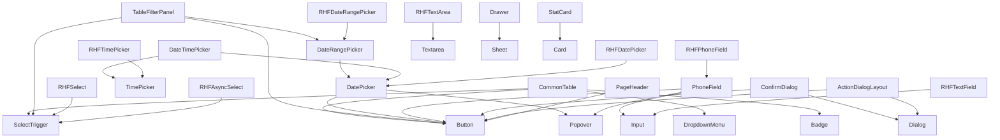

# Shared Component Catalog & Contract Specification

**Generated**: 2026-11-24  
**Source Directory**: `apps/web/src/components/{ui,common,hook-form,layout}`  
**Machine-Readable Catalog**: `docs/ui-standard/component-catalog.json`  
**Generator Script**: `scripts/ui-standard/generate-component-catalog.ts`

---

## 1. Catalog Summary & Statistics

| Metric                                   | Measured Value | Notes                                                                                              |
| :--------------------------------------- | :------------- | :------------------------------------------------------------------------------------------------- |
| **Total Components Analyzed**            | **58**         | Excludes test files and non-component utilities                                                    |
| **Active In-Use Components**             | **47**         | Directly consumed across application routes                                                        |
| **Unused Components (0 usages)**         | **9**          | Internal sub-primitives (`SelectChip`, `SelectList`, `SelectPopover`, etc.) and standalone helpers |
| **Near-Duplicates Detected**             | **2**          | `SelectFilter.tsx` vs `TableSelectFilter.tsx`, `ui/dropdown-menu` vs `common/DropdownMenu`         |
| **Components in Design System**          | **34**         | Live showcased on `/design-system` with state variations                                           |
| **Components with Dedicated Unit Tests** | **18**         | Co-located `*.test.tsx` files verified in Vitest                                                   |

---

## 2. Shared Component Architecture & Dependency Graph



---

## 3. Primitives Component Catalog (`src/components/ui`)

### `Button`

- **File**: `apps/web/src/components/ui/button.tsx`
- **Props**: `variant?: 'default' | 'destructive' | 'outline' | 'secondary' | 'ghost' | 'link' | 'danger'`, `size?: 'default' | 'sm' | 'lg' | 'icon'`, `asChild?: boolean`, standard `ButtonHTMLAttributes<HTMLButtonElement>`.
- **Default Values**: `variant = "default"`, `size = "default"`, `asChild = false`.
- **States Supported**: Default, Hover, Active, Focus-visible (`ring-2 ring-ring ring-offset-2`), Disabled (`disabled:opacity-50 disabled:pointer-events-none`).
- **Slots / Children**: `children: ReactNode` or Radix `Slot` when `asChild=true`.
- **Accessibility**: Native `<button type="button">`, supports `aria-label`, `aria-expanded`, keyboard `Enter` and `Space`.
- **External Dependencies**: `@radix-ui/react-slot`, `class-variance-authority`.
- **Usage Count**: **186 usages** across all modules.
- **Showcased on `/design-system`**: Yes (All variants, sizes, and disabled state).
- **Unit Tested**: Yes (`apps/web/src/components/ui/UIComponents.test.tsx` or module tests).
- **Real Usage Example** (`apps/web/src/pages/Dashboard.tsx:75`):
  ```tsx
  <Button
    variant="outline"
    size="sm"
    onClick={() => navigate(PATHS.assets.create)}
    className="min-h-[36px]"
  >
    Add Asset
  </Button>
  ```

---

### `Input`

- **File**: `apps/web/src/components/ui/input.tsx`
- **Props**: `type?: string`, `error?: boolean`, `sizeVariant?: 'sm' | 'md' | 'lg'`, `data-hm?: string`, standard `InputHTMLAttributes<HTMLInputElement>`.
- **Default Values**: `sizeVariant = "md"`, `data-hm = "input"`.
- **States Supported**: Default, Filled, Focus (`focus-visible:ring-2 focus-visible:ring-ring`), Disabled (`disabled:opacity-60 disabled:cursor-not-allowed`), Error (`aria-[invalid=true]:border-danger`).
- **Runtime Guard**: Renders `data-hm="input"` attribute on the DOM element for automated compliance checks.
- **Accessibility**: Native `<input>`, supports `aria-invalid`, `aria-describedby`, touch font-size >= 16px via `text-base sm:text-sm` (prevents iOS auto-zoom).
- **External Dependencies**: None (pure accessible HTML + Tailwind).
- **Usage Count**: **48 direct usages** + **40 via RHFTextField**.
- **Showcased on `/design-system`**: Yes (Default, error, disabled, sm/md/lg sizes).
- **Real Usage Example** (`apps/web/src/components/common/CommonTable.tsx:242`):
  ```tsx
  <Input
    placeholder="Search records..."
    value={globalFilter}
    onChange={(e) => setGlobalFilter(e.target.value)}
    className="max-w-xs h-9 text-base sm:text-sm"
  />
  ```

---

### `Textarea`

- **File**: `apps/web/src/components/ui/textarea.tsx`
- **Props**: `error?: boolean`, `data-hm?: string`, standard `TextareaHTMLAttributes<HTMLTextAreaElement>`.
- **Default Values**: `data-hm = "textarea"`.
- **States Supported**: Default, Focus (`focus-visible:ring-2 focus-visible:ring-ring`), Disabled (`disabled:opacity-60`), Error (`aria-[invalid=true]:border-danger`).
- **Runtime Guard**: Renders `data-hm="textarea"`.
- **Accessibility**: Native `<textarea>`, minimum height `min-h-[80px]`, `text-base sm:text-sm`.
- **Usage Count**: **10 direct usages** + **24 via RHFTextArea**.
- **Showcased on `/design-system`**: Yes.
- **Real Usage Example** (`apps/web/src/pages/RequestDetail.tsx:522`):
  ```tsx
  <Textarea
    placeholder="Enter rejection reason..."
    value={rejectionReason}
    onChange={(e) => setRejectionReason(e.target.value)}
    className="min-h-[100px]"
  />
  ```

---

### `Checkbox`

- **File**: `apps/web/src/components/ui/checkbox.tsx`
- **Props**: `checked?: boolean | 'indeterminate'`, `onCheckedChange?: (checked: boolean) => void`, `data-hm?: string`, standard button attributes.
- **States Supported**: Unchecked, Checked (Check icon), Indeterminate (Minus icon), Disabled.
- **Accessibility**: `role="checkbox"`, `aria-checked={checked}`, keyboard toggle via Space key.
- **Usage Count**: **9 direct usages** + **1 via RHFCheckbox**.
- **Showcased on `/design-system`**: Yes.
- **Real Usage Example** (`apps/web/src/pages/Roles.tsx:303`):
  ```tsx
  <Checkbox
    checked={selectedPermissions.includes(perm.id)}
    onCheckedChange={() => togglePermission(perm.id)}
    aria-label={`Permission ${perm.name}`}
  />
  ```

---

### `Radio` & `RadioGroup`

- **File**: `apps/web/src/components/ui/radio.tsx`
- **Props**: `RadioGroup`: `value: string`, `onValueChange: (val: string) => void`, `name?: string`. `Radio`: `value: string`, `label?: string`, `disabled?: boolean`.
- **Accessibility**: `role="radiogroup"`, `role="radio"`, `aria-checked`, arrow key navigation.
- **Usage Count**: **2 direct usages** + **1 via RHFRadioGroup**.
- **Showcased on `/design-system`**: Yes.
- **Real Usage Example** (`apps/web/src/components/common/TableFilters/TableFilterPanel.tsx:342`):
  ```tsx
  <RadioGroup value={selectedScope} onValueChange={setSelectedScope}>
    <Radio value="all" label="All Records" />
    <Radio value="mine" label="Assigned to Me" />
  </RadioGroup>
  ```

---

### `Switch`

- **File**: `apps/web/src/components/ui/switch.tsx`
- **Props**: `checked?: boolean`, `onCheckedChange?: (checked: boolean) => void`, `disabled?: boolean`, `data-hm?: string`.
- **Accessibility**: `role="switch"`, `aria-checked`, keyboard toggle via Space/Enter.
- **Usage Count**: **11 direct usages** + **6 via RHFSwitch**.
- **Showcased on `/design-system`**: Yes.
- **Real Usage Example** (`apps/web/src/pages/NotificationPreferences.tsx:101`):
  ```tsx
  <Switch
    checked={preferences.emailAlerts}
    onCheckedChange={(checked) => updatePreference("emailAlerts", checked)}
    aria-label="Email Alerts Toggle"
  />
  ```

---

### `Badge` & `StatusBadge`

- **File**: `apps/web/src/components/ui/badge.tsx` & `apps/web/src/components/common/StatusBadge.tsx`
- **Props (`StatusBadge`)**: `status: string | number`, `customLabel?: string`, `size?: 'sm' | 'md'`.
- **Tones Supported**: `success` (active/operational), `warning` (pending/maintenance), `danger` (rejected/retired), `info` (draft), `neutral` (inactive/closed).
- **Accessibility**: Text badge with semantic foreground/background contrast (all >= 4.5:1).
- **Usage Count**: **44 usages**.
- **Showcased on `/design-system`**: Yes.
- **Real Usage Example** (`apps/web/src/components/employees/EmployeeColumns.tsx:64`):
  ```tsx
  <StatusBadge status={row.original.status} />
  ```

---

### `PhoneField` & `PhoneDisplay`

- **File**: `apps/web/src/components/ui/phone-field/PhoneField.tsx` & `PhoneDisplay.tsx`
- **Props (`PhoneField`)**: `value?: string`, `onChange?: (e164: string) => void`, `defaultCountry?: string`, `disabled?: boolean`, `readOnly?: boolean`, `data-hm?: string`.
- **Features**: Country code selector popover with searchable ISO country list (240+ countries), national formatting as user types, international paste normalization, minimum touch target 44px.
- **Accessibility**: Country trigger button with accessible label: `${code} ${dialCode} ${name}. Click to change country.`, `aria-haspopup="dialog"`, `aria-expanded`.
- **External Dependencies**: `libphonenumber-js`, `lucide-react`.
- **Usage Count**: **3 direct usages** + **2 via RHFPhoneField**.
- **Showcased on `/design-system`**: Yes.
- **Unit Tested**: Yes (`apps/web/src/components/ui/phone-field/PhoneField.test.tsx`, 8 tests, 100% pass).
- **Real Usage Example** (`apps/web/src/components/employees/AddEditEmployee.tsx:185`):
  ```tsx
  <RHFPhoneField
    name="phone"
    label="Phone Number"
    placeholder="Enter phone number"
    required
  />
  ```

---

### `DatePicker`, `DateRangePicker`, `TimePicker`, `DateTimePicker`

- **File**: `apps/web/src/components/ui/date-picker/DatePicker.tsx`, `DateRangePicker.tsx`, `TimePicker.tsx`, `DateTimePicker.tsx`
- **Props (`DatePicker`)**: `value?: string` (`YYYY-MM-DD`), `onChange?: (date: string) => void`, `placeholder?: string`, `minDate?: string`, `maxDate?: string`, `disabled?: boolean`, `clearable?: boolean`.
- **Props (`DateRangePicker`)**: `value?: { from?: string; to?: string }`, `onChange?: (range: { from: string; to: string }) => void`, presets support (Today, Last 7d, Last 30d, FY).
- **Value Contract**: String values only (`YYYY-MM-DD`, `HH:mm`) ensuring **zero UTC drift**.
- **Accessibility**: Popover dialog `role="dialog"`, responsive Sheet on mobile viewports (<= 640px), keyboard arrow navigation, clear button with `aria-label`.
- **External Dependencies**: `react-day-picker` v10, `date-fns`.
- **Usage Count**: **16 usages** across modules.
- **Showcased on `/design-system`**: Yes.
- **Unit Tested**: Yes (`apps/web/src/components/ui/date-picker/DatePicker.test.tsx`, 14 tests, 100% pass).
- **Real Usage Example** (`apps/web/src/components/assets/AddEditAsset.tsx:210`):
  ```tsx
  <RHFDatePicker
    name="purchase_date"
    label="Purchase Date"
    placeholder="Select purchase date"
  />
  ```

---

## 4. Complex Shared Components (`src/components/common`)

### `CommonTable`

- **File**: `apps/web/src/components/common/CommonTable.tsx`
- **Props**: `columns: ColumnDef<T>[]`, `data: T[]`, `isLoading?: boolean`, `totalCount?: number`, `pagination?: PaginationState`, `onPaginationChange?: OnChangeFn<PaginationState>`, `sorting?: SortingState`, `onSortingChange?: OnChangeFn<SortingState>`, `onRowClick?: (row: T) => void`, `rowActions?: (row: T) => RowAction[]`.
- **Features**: Responsive horizontal scroll wrapper with shadow indicators, mobile card list fallback, skeleton preloading, empty state integration, rows-per-page selector, sortable headers.
- **Accessibility**: `<table>`, `<thead>`, `<tbody>`, `aria-sort`, accessible pagination buttons (`min-h-[36px]`).
- **Usage Count**: **15 usages** (The core table engine for every list screen).
- **Showcased on `/design-system`**: Yes.
- **Real Usage Example** (`apps/web/src/pages/Employees.tsx:120`):
  ```tsx
  <CommonTable
    columns={employeeColumns}
    data={employees}
    isLoading={isLoading}
    totalCount={totalCount}
    pagination={pagination}
    onPaginationChange={setPagination}
  />
  ```

---

### `TableFilterPanel`

- **File**: `apps/web/src/components/common/TableFilters/TableFilterPanel.tsx`
- **Props**: `filters: FilterConfig[]`, `values: Record<string, any>`, `onChange: (vals: Record<string, any>) => void`, `onReset: () => void`, `activeCount?: number`.
- **Responsive Behavior**: Desktop renders as right-side slide-over drawer (576px); mobile (<= 640px) renders as bottom sheet with `100vw x 100dvh` and safe-area padding.
- **Components Used**: `SelectTrigger`, `DateRangePicker`, `Button`, `Badge`.
- **Usage Count**: **8 usages** (Assets, Employees, Software, Requests, Offboarding, Reports, Audit Logs).
- **Showcased on `/design-system`**: Yes.

---

### `ConfirmDialog` & `ActionDialogLayout`

- **File**: `apps/web/src/components/common/ConfirmDialog.tsx` & `ActionDialogLayout.tsx`
- **Props (`ConfirmDialog`)**: `open: boolean`, `onOpenChange: (open: boolean) => void`, `title: string`, `description: string`, `confirmLabel?: string`, `cancelLabel?: string`, `variant?: 'danger' | 'warning' | 'primary'`, `onConfirm: () => void | Promise<void>`, `isLoading?: boolean`.
- **Accessibility**: `role="alertdialog"`, `aria-labelledby`, `aria-describedby`, focus trapped, `Escape` key close.
- **Usage Count**: **22 usages** across delete, status change, and approval flows.
- **Showcased on `/design-system`**: Yes.
- **Real Usage Example** (`apps/web/src/pages/Assets.tsx:210`):
  ```tsx
  <ConfirmDialog
    open={deleteConfirmOpen}
    onOpenChange={setDeleteConfirmOpen}
    title="Delete Asset"
    description="Are you sure you want to delete this asset? This action cannot be undone."
    variant="danger"
    confirmLabel="Delete"
    onConfirm={handleDelete}
    isLoading={isDeleting}
  />
  ```

---

### `PageHeader`

- **File**: `apps/web/src/components/common/PageHeader.tsx`
- **Props**: `title: string`, `description?: string`, `breadcrumbs?: { label: string; href?: string }[]`, `actions?: ReactNode`.
- **Responsive Behavior**: Title & actions stack vertically on mobile (`flex-col gap-3 sm:flex-row`), breadcrumbs provide `min-h-[36px]` interactive touch targets.
- **Accessibility**: `<nav aria-label="Breadcrumb">`, `<h1 className="text-xl sm:text-2xl font-bold">`.
- **Usage Count**: **26 usages** across all top-level views.
- **Showcased on `/design-system`**: Yes.

---

## 5. Duplicate and Unused Components Analysis

### Unused Components (Zero Direct Usages)

1. `apps/web/src/components/ui/select/SelectChip.tsx`: Internal sub-component of `Select`.
2. `apps/web/src/components/ui/select/SelectList.tsx`: Internal sub-component of `Select`.
3. `apps/web/src/components/ui/select/SelectOption.tsx`: Internal sub-component of `Select`.
4. `apps/web/src/components/ui/select/SelectPopover.tsx`: Internal sub-component of `Select`.
5. `apps/web/src/components/ui/select/SelectSearchInput.tsx`: Internal sub-component of `Select`.
6. `apps/web/src/components/common/PasswordGenerator.tsx`: Standalone button helper not directly referenced outside password generators.
7. `apps/web/src/components/hook-form/RHFDateTimePicker.tsx`: Fully built DateTime hook-form wrapper awaiting module adoption.
8. `apps/web/src/components/ui/dropdown-menu.tsx`: Bare Radix export; wrapped by `components/common/DropdownMenu.tsx`.

### Near-Duplicates Detected

1. **`SelectFilter.tsx` vs `TableSelectFilter.tsx`**:
   - `SelectFilter.tsx` is an older, legacy filter dropdown implementation.
   - `TableSelectFilter.tsx` is the modernized filter component with search and multiselect.
   - _Recommendation_: Deprecate `SelectFilter.tsx` in favor of `TableSelectFilter.tsx` and `TableFilterPanel.tsx`.
2. **`components/ui/dropdown-menu.tsx` vs `components/common/DropdownMenu.tsx`**:
   - `components/ui/dropdown-menu.tsx` exposes low-level Radix primitives (`DropdownMenuTrigger`, `DropdownMenuContent`).
   - `components/common/DropdownMenu.tsx` is an ergonomic wrapper with built-in item triggers and icon support.
   - _Recommendation_: Keep both; document `components/ui` as primitive and `components/common` as the standard consumer wrapper.
